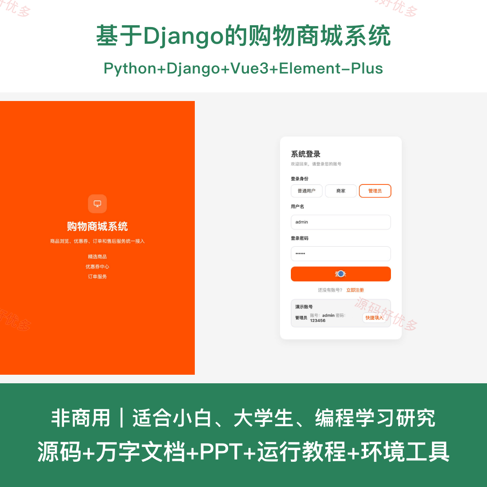
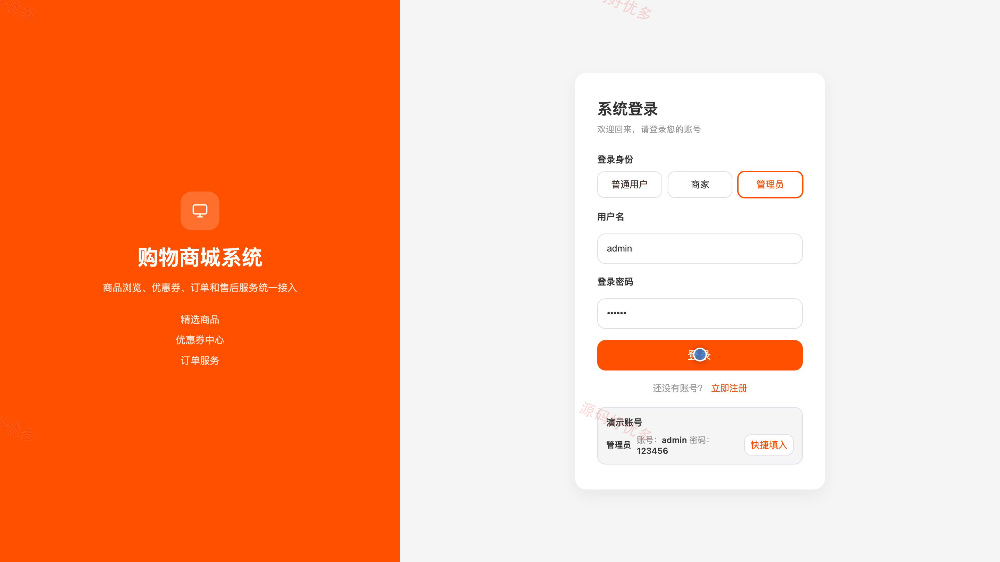
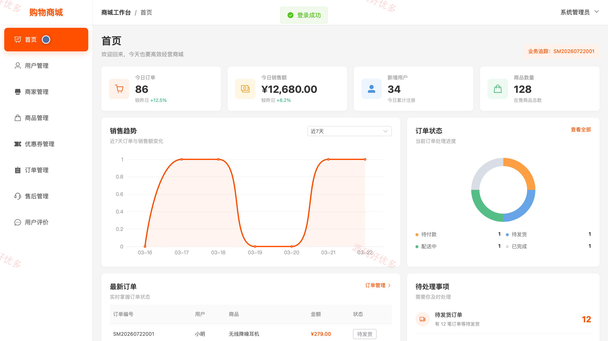
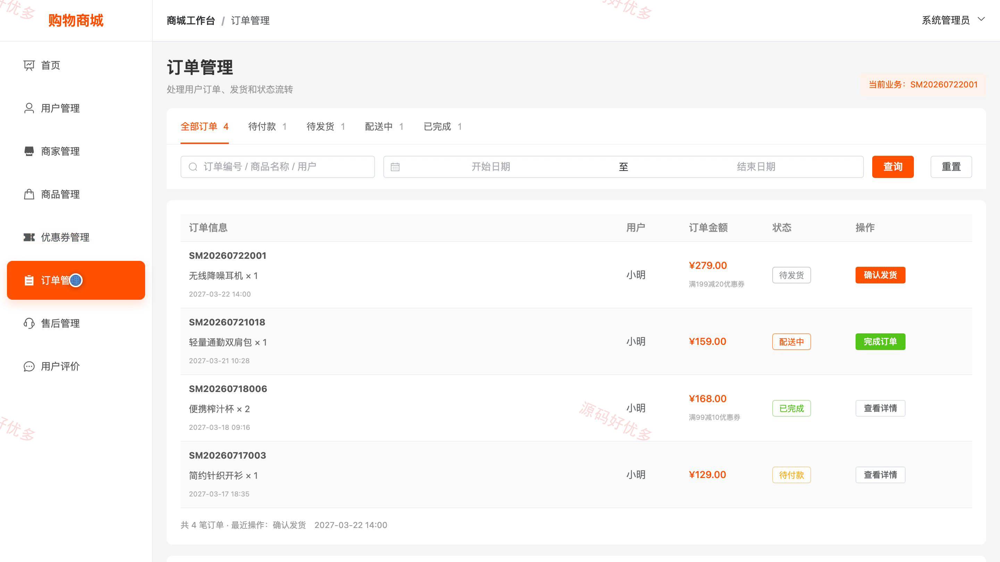
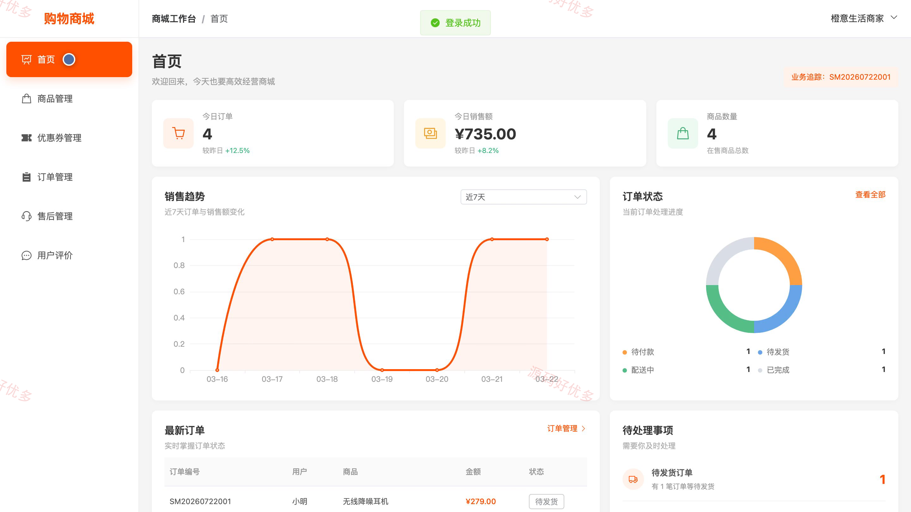
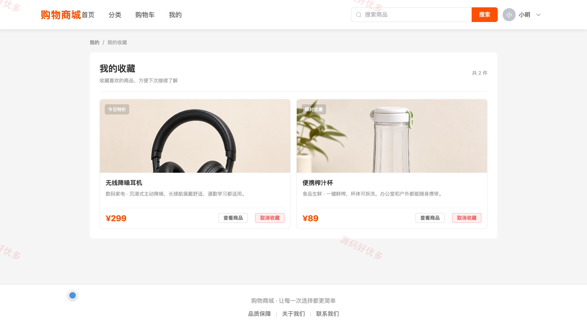
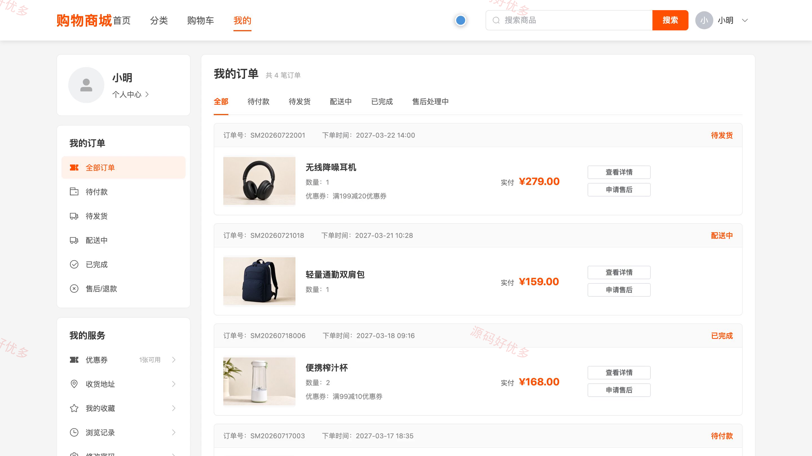

# bs002C
bs002C基于Django的购物商城系统源码 Python Django Vue3 设计文档 PPT
## 源码问题查看主页咨询

### 一、关键词
网上购物、电子商城、商品交易、在线零售、购物订单

### 二、作品包含
源码+数据库+万字设计文档+PPT+全套环境和工具资源+本地部署教程

### 三、项目技术
前端技术： Html、Css、Js、Vue3.4、Element-Plus
后端技术：Python、Django

### 四、运行环境要求
开发工具：PyCharm + VSCODE

数据库：MySQL5.7+（共9张表）

数据库管理工具：Navicat10以上版本

环境配置软件： Python3+

前端Nodejs：16+

浏览器：谷歌浏览器

### 五、项目介绍
项目编号：bs002C

系统面向用户、商家和管理员，串联商品展示、购物车、优惠券、订单、售后和评价等商城业务；商家可维护自营商品并处理订单，管理员负责平台数据、用户和商家入驻管理。

角色：用户、商家、管理员

用户功能：商品浏览与搜索、商品分类筛选、购物车管理、优惠券领取、订单提交与查询、收货地址管理、收藏与浏览记录、个人资料与密码管理。

商家功能：经营数据看板、自营商品管理、优惠券发布与管理、订单查询与状态处理、售后申请处理、用户评价查看与回复。

管理员功能：平台经营数据看板、用户管理、商家入驻审核、商品管理、优惠券管理、订单状态管理、售后管理、用户评价管理。

### 六、运行截图

